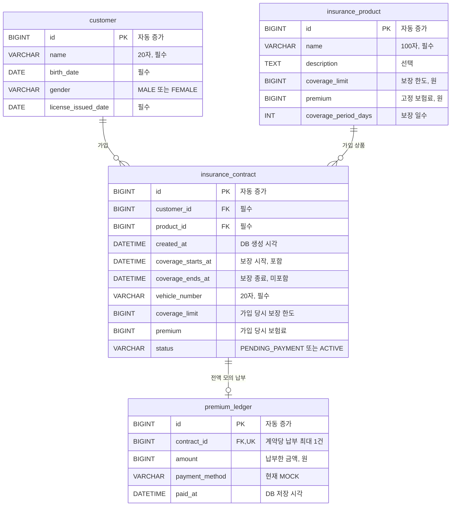

# 보험 서비스 ERD 및 API

자동차보험의 대물배상을 소재로 보험 가입부터 사고 보상까지 구현하는 서비스입니다.  
현재 상품 조회·관리, 고객 조회, 계약 가입·조회, 보험료 납부를 구현했습니다.  
앞으로 사고 접수, 보험사 심사, 보험금 모의 지급 기능으로 확장할 예정입니다.

## ERD

## API 목록

| 메서드 | 주소                                       | 기능                         | 정상 응답      |
|--------|--------------------------------------------|------------------------------|----------------|
| GET    | `/api/product`                             | 상품 목록                    | 200, 배열      |
| GET    | `/api/product/{id}`                        | 상품 상세                    | 200, 객체      |
| POST   | `/api/product`                             | 상품 등록                    | 201, 본문 없음 |
| PATCH  | `/api/product`                             | JSON의 `id`로 상품 이름 수정 | 200, 본문 없음 |
| DELETE | `/api/product/{id}`                        | 상품 삭제                    | 204            |
| GET    | `/api/customer`                            | 고객 목록                    | 200, 배열      |
| GET    | `/api/customer/{id}`                       | 고객 상세                    | 200, 객체      |
| POST   | `/api/contract`                            | 계약 생성                    | 201, 생성된 ID |
| GET    | `/api/customer/{customerId}/contracts`     | 고객의 계약 목록             | 200, 배열      |
| GET    | `/api/contracts/{id}`                      | 계약 상세                    | 200, 객체      |
| POST   | `/api/contracts/{contractId}/mock-payment` | 모의 보험료 납부             | 200, 납부 객체 |
