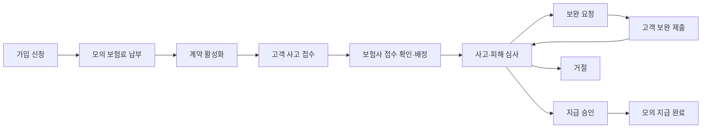
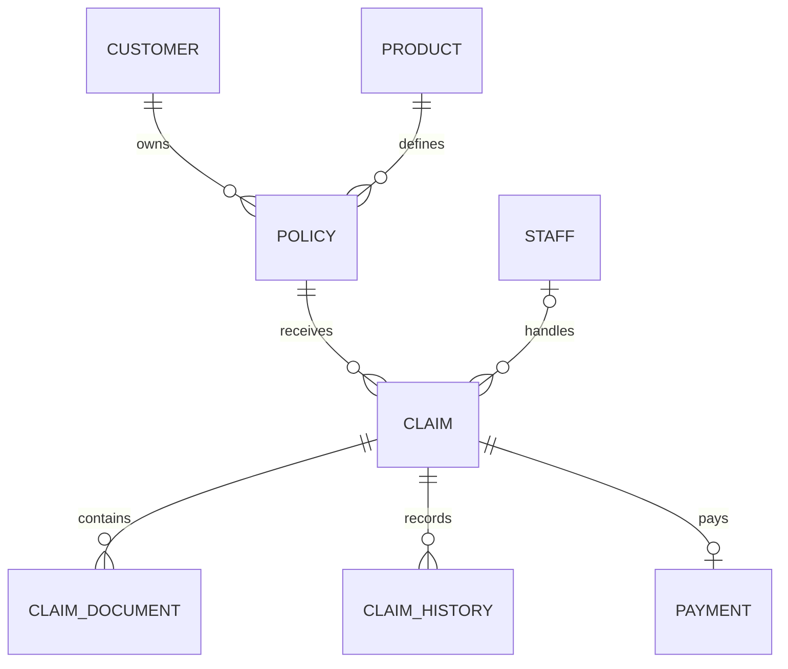

# 삼성 애니카 자동차보험을 참고한 대물배상 서비스 설계

작성일: 2026-11-02

## 1. 목표와 자료의 범위

고객 보험 가입 → 고객 사고 접수(보상 신청) → 보험사 접수 확인·심사 → 보험금 지급까지 직접 구현한다. 여기서 ‘보험 신청’은 가입 신청과 혼동하지 않도록 가입 이후에는 ‘사고 접수’로 부른다.

대물배상만 제공하는 가상 상품 하나를 만든다. 실제 삼성화재 상품이나 내부 시스템을 복제하는 설계가 아니다. 대물배상만 독립 가입하는 실제 상품의 판매 가능성을 전제하지 않는다. 가입 조건·보험료·심사 규칙은 아래의 학습용 가정을 적용한다.

### 확인한 공식 자료

확인 날짜는 모두 2026-11-02이다.

| 자료 | 활용 범위 |
|---|---|
| [삼성화재 자동차 사고 보상처리 안내](https://d.samsungfire.com/m/claim/MP040101_001.html) | 접수, 담당자 지정, 조사, 보험금 산정·지급, 종결의 순서 |
| [삼성화재 자동차 사고접수·보상 안내](https://direct.samsungfire.com/m/claim/accident.html) | 사고 배당과 피해 확인 과정의 교차 확인 |
| [삼성화재 보상서비스](https://d.samsungfire.com/claim/submain.html) | 자동차 사고 접수와 자동차 외 보험금 신청의 구분 |
| [사용자가 기록한 상품 페이지](https://www.samsungfire.com/vh/page/VH.HPPD0100.do) | 상품 분석 출발점. 이번 조사에서는 이 페이지의 본문과 약관 버전을 검증하지 않음 |

공식 모바일 안내에서 확인한 흐름은 **사고 접수 → 담당자 지정 → 사고 조사 → 피해 조사 → 보험금 산정·지급 → 종결**이다. 차량 피해 확인에는 사고 내용, 파손 사진, 정비업체 견적서 등을 활용한다고 안내한다. 아래의 API, 테이블, 상태명, 필수 서류와 자동 검증은 이 공개 흐름을 참고해 직접 정한 설계다. [출처](https://d.samsungfire.com/m/claim/MP040101_001.html)

사용자가 제공한 상품 요약상 대물배상은 타인의 차량·재물에 대한 배상책임을 다룬다. 따라서 가입 고객, 피해자, 지급받는 사람을 같은 사람으로 취급하지 않는다. 이 프로젝트에서는 피해자 한 명의 차량 수리비만 다루고, 지급 대상은 그 피해자로 고정한다. 실제 수취인 결정·정비업체 직접 지급 규칙은 이번 조사에서 확정하지 않았다.

## 2. 첫 버전의 범위와 가정

| 항목 | 학습용 결정 |
|---|---|
| 사용자 | 고객과 보험사 담당자. 고객은 자기 계약·사고만 조회 가능 |
| 상품 | 대물배상 상품 1개, 가입 한도 2,000만원 고정 |
| 가입 관계 | 계약자 = 피보험자 = 차량 소유자 = 사고 운전자 |
| 가입 대상 | 계약당 차량 1대. 같은 차량의 보험기간 중복 가입 차단 |
| 보험료 | 10만원 고정, 모의 납부 성공으로 처리. 실제 요율과 무관 |
| 계약 기간 | 사용자가 선택한 미래 시작일 00:00부터 1년. 종료 시각은 미포함 |
| 가입 심사 | 필수 입력 검증 후 가입 신청 저장, 모의 납부 성공 시 계약 활성화 |
| 사고 | 계약당 여러 사고 허용, 사고당 피해자 1명·피해 차량 1대 |
| 보상 | 수리비만 취급. 과실·면책 자동 판정은 하지 않음 |
| 심사 | 담당자가 보상 가능 여부, 인정 손해액, 승인금액, 사유를 기록 |
| 서류 | 파손 사진과 수리 견적서를 학습용 필수 자료로 설정 |
| 지급 | 승인된 사고당 1회 전액 모의 지급. 외부 은행 송금 없음 |
| 제외 | 인명 피해, 렌트비, 구상, 분할·추가 지급, 계약 갱신·해지·변경, 보험사 간 협의 |

고정 보험료와 가입 한도는 실습용 데이터다. 약관 기반 보험금 산정 공식이라고 설명하지 않는다. 승인금액은 0보다 크고, 담당자가 입력한 인정 손해액 및 계약 한도를 넘지 않도록 검증한다. 고객의 예상 수리비는 참고 입력이며 지급액으로 자동 복사하지 않는다.

## 3. 사용자별 흐름

### 고객 가입

1. 상품과 가입 한도를 확인한다.
2. 샘플 고객 정보, 차량번호, 보험 시작일을 입력한다.
3. 서버가 미래 시작일과 기존 계약의 기간 중복을 검사하고 가입 신청을 생성한다.
4. 모의 보험료 납부를 완료한다.
5. 계약번호, 보험기간, 가입금액을 확인한다.

납부 전 상태는 `PENDING_PAYMENT`, 모의 납부 완료 상태는 `ACTIVE`로 둔다. `ACTIVE`여도 사고 발생 시각이 보험기간에 속해야 보상 검토 대상이 된다. 실제 가입 심사와 효력 발생 조건을 재현한 규칙은 아니다.

### 고객 사고 접수

1. 본인 계약을 선택한다.
2. 사고 발생 시각·장소·경위와 피해자·피해 차량 정보를 입력한다.
3. 예상 수리비를 입력하고 파손 사진·견적서를 제출한다. 최초 접수 때 서류가 없어도 접수는 가능하다.
4. 접수번호와 진행 상태를 확인한다.
5. 보완 요청이 있으면 자료를 추가하고 보완 완료를 제출한다.

보험기간 판정은 접수 시각이 아닌 사고 발생 시각을 기준으로 한다. 보험기간이 끝난 뒤에도 기간 내 사고는 접수할 수 있게 한다. 청구기한 자동 검증은 첫 버전에서 제외한다. 미래 사고 시각과 계약 소유권 위반은 입력 단계에서 거절한다. 기간 밖 사고도 접수 기록은 남기되 심사 승인 단계에서 차단하고 담당자가 거절 사유를 기록한다.

### 보험사 확인과 지급

1. 담당자가 미확인 접수 목록을 조회한다.
2. 접수 확인을 누르면 자신에게 배정되고 심사 중으로 바뀐다.
3. 계약, 사고일, 자료, 피해자 정보를 확인한다.
4. 자료가 부족하면 보완 사유를 기록한다.
5. 보상 가능 여부를 판단하고 승인금액과 근거를 입력하거나 거절한다.
6. 승인 건에서 모의 지급을 실행한다.
7. 지급 기록과 사고 상태가 함께 반영되면 고객에게 지급 결과를 보여준다.

대물배상 고객이 접수했다는 이유만으로 고객 계좌로 지급하지 않는다. 지급 화면에는 피해자인 수취인의 식별 정보와 모의 지급 대상이 별도로 표시된다.

## 4. 상태와 변경 규칙

계약 상태와 사고 상태는 별도 필드로 관리한다.

| 사고 상태 | 의미 | 가능한 다음 상태 | 변경 주체 |
|---|---|---|---|
| RECEIVED | 고객 접수 저장 완료 | UNDER_REVIEW | 담당자 |
| UNDER_REVIEW | 담당자 배정·심사 중 | NEEDS_INFO, APPROVED, REJECTED | 배정 담당자 |
| NEEDS_INFO | 보완 대기 | UNDER_REVIEW | 고객의 보완 완료 제출 |
| APPROVED | 금액·수취인 확정 | PAID | 배정 담당자의 지급 실행 |
| REJECTED | 보상 불가 결과 기록 | 없음 | 종료 |
| PAID | 모의 지급 완료 | 없음 | 종료 |

첫 버전은 지급 완료와 종결을 합친다. 접수 확인은 지급 승인이 아니다. 보완 중에는 승인할 수 없고, 승인 후 금액·수취인은 수정할 수 없다. 거절·보완 요청에는 사유가 필수다. 파일 업로드만으로 상태가 바뀌지 않고 고객의 보완 완료 제출로 심사를 재개한다. 모든 상태 변경은 변경 전후 상태, 작업자, 시각, 사유를 이력에 남긴다.

## 5. ERD 초안

실제 보험사 데이터 모델이 아닌 위 범위에 필요한 최소 모델이다. 첫 버전에서는 사고와 보상 신청을 `claim` 하나로 합친다. 피해자가 여러 명이거나 보장이 여러 개가 되면 사고와 보상 건을 분리한다.

| 테이블 | 주요 필드·역할 |
|---|---|
| customer | id, name, 샘플 연락처 |
| staff | id, name |
| product | id, name, version, coverage_limit, fixed_premium |
| policy | id, policy_number, customer_id, product_id, vehicle_number, starts_at, ends_at, coverage_limit, premium, status, paid_at |
| claim | id, receipt_number, policy_id, assigned_staff_id, occurred_at, location, description, victim_name, victim_vehicle_number, estimated_amount, assessed_amount, approved_amount, recipient_reference, decision_reason, status, version |
| claim_document | id, claim_id, type, storage_key, original_name, uploaded_by, uploaded_at |
| claim_history | id, claim_id, from_status, to_status, actor_id, actor_role, reason, created_at |
| payment | id, claim_id, amount, recipient_reference, idempotency_key, mock_transfer_reference, paid_at |

`policy`의 한도와 보험료는 가입 시점 값으로 복사해 보관한다. 상품 정보가 수정되어도 기존 계약 조건이 바뀌지 않게 하기 위해서다. `recipient_reference`는 실제 계좌 대신 사용하는 가짜 지급 대상 식별자다. `payment`에도 승인된 수취인과 금액을 복사해 지급 당시 기록을 보존한다.

주요 제약:

- 계약번호와 접수번호는 UNIQUE.
- `payment.claim_id`는 UNIQUE: 사고당 지급 1건.
- 금액은 원 단위 BIGINT와 양수/비음수 CHECK 제약을 사용한다.
- `starts_at < ends_at`. 기간은 `[starts_at, ends_at)`로 취급한다.
- 시각은 PostgreSQL `timestamptz`, 화면과 계약 경계 계산은 Asia/Seoul 기준이다. 1년 후 동일 날짜를 사용하며 2월 29일은 다음 해 2월 28일로 정한다.
- 중복 가입은 차량번호를 정규화하고, PENDING_PAYMENT·ACTIVE 계약의 기간 중복을 PostgreSQL exclusion constraint 등으로 차단한다. 단순 사전 조회만으로 동시 가입을 막았다고 보지 않는다.
- 실습 고객·피해자·계좌는 모두 가짜 데이터를 사용한다.

## 6. API 초안

URL의 고객 ID를 신뢰하지 않고 로그인된 사용자를 기준으로 소유권을 검사한다. 초기에는 테스트용 고객/담당자 인증으로 시작해도 권한 검증은 서버에서 수행한다.

| 주체 | API | 동작 |
|---|---|---|
| 고객 | GET /products | 상품 1개 조회 |
| 고객 | POST /policies | 가입 신청 생성 |
| 고객 | POST /policies/{id}/mock-premium-payment | 모의 납부·계약 활성화 |
| 고객 | GET /policies/{id} | 본인 계약 조회 |
| 고객 | POST /claims | 본인 계약의 사고 접수 |
| 고객 | GET /claims/{id} | 진행 상태·이력·지급 결과 조회 |
| 고객 | POST /claims/{id}/documents | 자료 제출 |
| 고객 | POST /claims/{id}/supplement-completion | 보완 완료 제출 |
| 담당자 | GET /admin/claims?status=RECEIVED | 접수 목록 조회 |
| 담당자 | POST /admin/claims/{id}/accept | 접수 확인 및 자신에게 배정 |
| 담당자 | POST /admin/claims/{id}/request-info | 사유를 포함한 보완 요청 |
| 담당자 | POST /admin/claims/{id}/decision | 승인 또는 거절 결정 |
| 담당자 | POST /admin/claims/{id}/payment | 승인금액으로 모의 지급 |

가입·접수 생성에는 요청 키를 사용해 네트워크 재시도 시 같은 결과를 돌려준다. 키는 사용자와 작업 종류 범위에서 유일하게 관리하고 요청 본문 해시와 결과 ID를 저장한다. 동일 키·다른 본문은 409로 거절한다. 이를 위한 `request_deduplication` 보조 테이블은 업무 ERD에서 생략했다.

지급 요청에는 금액을 다시 받지 않고 승인 기록을 사용한다. 지급 키를 바꿔 재요청해도 `claim_id` 유일 제약으로 중복 지급을 막는다. 이미 완료된 지급 요청에는 기존 지급 결과를 반환한다. 상태 충돌은 409, 잘못된 입력은 400, 권한 위반은 403으로 정의한다.

## 7. 트랜잭션과 지급 설계

접수 확인·보완·심사 결정은 사고 행을 잠그고 현재 상태와 작업자 권한을 확인한 뒤, 상태 변경과 이력 저장을 하나의 트랜잭션으로 커밋한다. 다른 담당자가 이미 배정한 건은 접수 확인에 실패해야 한다. `version`은 화면에서 오래된 정보를 보고 승인하는 경우를 감지하는 데 사용할 수 있다.

모의 지급은 아래를 하나의 DB 트랜잭션으로 실행한다.

1. 사고 행을 `SELECT ... FOR UPDATE`로 잠근다.
2. 이미 지급 기록이 있으면 기존 결과를 반환한다.
3. 배정 담당자·APPROVED 상태·승인금액·수취인을 검증한다.
4. `payment` 기록을 저장한다.
5. 사고를 PAID로 변경하고 이력을 저장한다.
6. 커밋 후 결과를 반환한다.

중간 예외가 발생하면 지급 기록과 상태 변경 모두 롤백되어야 한다. 이 설계가 보장하는 것은 로컬 DB의 모의 지급 기록이며 실제 송금이 아니다. 외부 은행을 붙이는 단계에서는 송금 성공 후 응답 유실을 DB 롤백으로 해결할 수 없으므로 지급 요청 상태, 외부 멱등성 키, 결과 조회·대사 작업을 별도 설계해야 한다.

## 8. 구현 순서와 완료 기준

사용자가 원하는 전체 흐름을 유지하되, 각 단계마다 실행 가능한 결과를 만든다. guide.md의 주간 범위보다 기능이 많으므로 한 주에 모두 끝내는 것을 전제로 하지 않는다.

| 단계 | 구현할 것 | 완료를 보여줄 결과 |
|---|---|---|
| 1. 가입 | 상품 seed, 고객·계약 테이블, 가입·모의 납부 API | 고객이 계약번호와 확정된 보험기간·한도를 조회 |
| 2. 접수 | 사고 입력·접수번호·상세 조회 | 해당 계약에 접수 건이 연결됨 |
| 3. 심사 | 담당자 확인, 자료 제출·보완, 승인·거절, 이력 | 보완 요청 후 다시 심사하여 승인 가능 |
| 4. 지급 | 모의 지급·상태·멱등성 | 승인 건을 한 번 지급하고 결과 조회 |
| 5. 검증 | PostgreSQL 통합 테스트와 데모 | 실패 흐름과 최종 DB 상태 확인 |

먼저 API로 연결하고 고객용 계약·접수 화면, 담당자용 접수 목록·상세 화면을 추가한다. 첫 단계의 보험료 납부도 실제 결제 연동 없이 구현한다.

### 정상 시나리오

1. 고객 A가 차량 A로 가입하고 모의 보험료 납부를 완료한다.
2. 테스트 시계를 계약 시작 이후로 이동한다. 미래 사고를 접수하는 방식으로 테스트하지 않는다.
3. 기간 내 사고를 접수하고 피해자 B의 차량 손해 및 예상 수리비 120만원을 입력한다.
4. 담당자가 확인 후 견적서 보완을 요청한다.
5. 고객이 자료를 보완한다.
6. 담당자가 인정 손해액과 승인금액을 각각 100만원으로 입력한다. 이는 모의 심사 값이다.
7. 피해자 B를 수취인으로 모의 지급한다.
8. 지급 1건·100만원, PAID 상태, 전체 변경 이력을 확인한다.

### 필수 실패 실험

| 상황 | 기대 결과 |
|---|---|
| 고객 B가 고객 A의 계약으로 접수 | 권한 오류, 사고 저장 안 됨 |
| 보험기간 밖 사고를 승인 | 승인 거절, 기존 상태 유지 |
| 보완 대기 상태에서 승인 | 상태 오류, 승인금액 저장 안 됨 |
| 승인금액이 계약 한도를 초과 | 검증 실패 |
| 두 담당자가 동시에 접수 확인 | 한 담당자만 배정됨 |
| 동일 사고 지급을 동시에 5회 요청 | 지급 기록 1건, 지급액 1회분, PAID 이력 1건 |
| 지급 기록 저장 직후 예외 | payment 없음, 사고는 APPROVED 유지 |
| 커밋 후 응답 유실을 가정하고 지급 재요청 | 기존 지급 ID 반환, 추가 지급 없음 |
| 같은 가입 요청 키를 다른 차량에 재사용 | 409, 추가 계약 없음 |
| 계약 종료 시각과 사고 시각이 같음 | 종료 미포함 규칙에 따라 승인 불가 |

동시성·롤백은 실제 PostgreSQL에서 검증한다. HTTP 성공 개수뿐 아니라 지급 건수·금액·사고 상태·이력도 확인한다.

## 9. 구현 전에 작성할 짧은 분석 노트

- 실제 자료로 확인한 것: 공식 접수·조사·지급 순서와 차량 피해 조사에 활용하는 자료.
- 직접 정한 것: 상품 하나, 고정 보험료·한도, 가입 관계, 피해자 한 명, 필수 서류, 상태 규칙, 1회 모의 지급.
- 추가 자료가 필요한 것: 실제 가입 조건과 보험료 산출, 해당 버전 약관의 지급·면책 조건, 실제 수취인과 필요 서류, 과실 및 손해액 산정.

첫 개발 작업은 **상품·고객 샘플 데이터와 계약 생성 → 모의 보험료 납부 → 계약 조회**이다. 이 흐름을 먼저 완성한 뒤 같은 계약에 사고를 접수하면 전체 업무를 단계적으로 이해할 수 있다.
